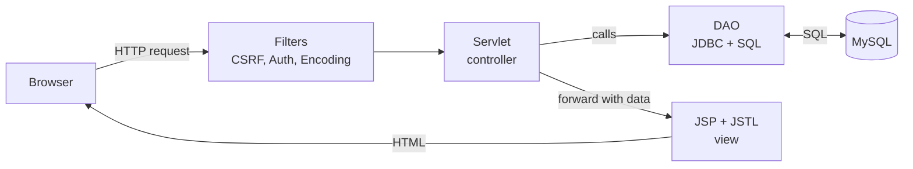
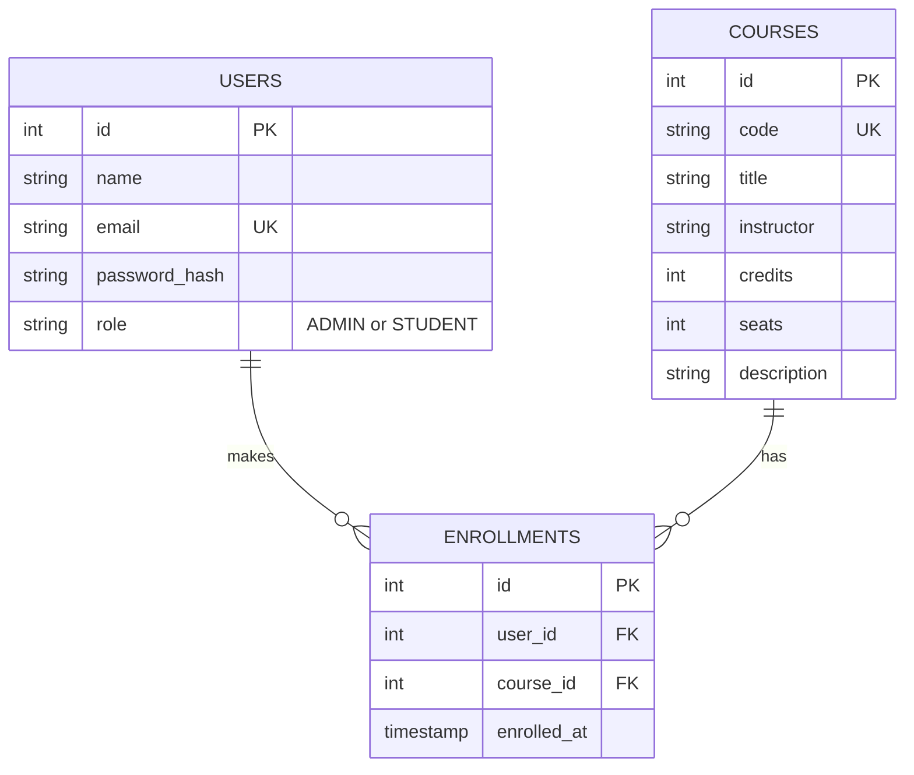

# Online Course Registration System

[](https://github.com/PrasannaTheBest/course-registration-system-sem5/actions/workflows/ci.yml)


A web application where students browse a course catalogue and register for courses online, and
administrators manage the catalogue. Built with **Java Servlets, JSP/JSTL, JDBC and MySQL** using a clean
MVC structure, no frameworks.

> Semester 5 project, *Project Based Learning in Java* (PBLJ), project #18: **Online Course Registration System**.

## Table of contents

- [Features](#features)
- [Tech stack](#tech-stack)
- [Getting started](#getting-started)
- [Default accounts](#default-accounts)
- [How it works](#how-it-works)
- [Business rules](#business-rules)
- [URL routes](#url-routes)
- [Security](#security)
- [Testing and CI](#testing-and-ci)
- [Project structure](#project-structure)
- [Viva cheat-sheet](#viva-cheat-sheet)
- [Future improvements](#future-improvements)
- [License](#license)

## Features

**Students**
- Sign up and log in
- Browse all courses with live seat availability and an animated seat-fill bar
- Search by course code, title or instructor
- Enrol in a course and drop it again
- "My Courses" page with enrolment dates and a credit counter (`n / 24`)

**Administrators**
- Dashboard with totals for courses, students and enrolments
- Add, edit and delete courses (with validation)
- See exactly which students are enrolled in each course

**Interface**
- Smooth page-load animations: fading cards that appear one after another, animated seat bars and count-up numbers
- Hover lift on cards and buttons, loading spinner on submit buttons (stops double clicks), messages that fade away on their own
- Respects the operating system's "reduce motion" setting; plain CSS plus a small `app.js`, no libraries

## Tech stack

| Layer | Technology |
|---|---|
| Language | Java 11+ |
| Web | Servlet 4.0, JSP 2.3, JSTL 1.2, EL |
| Database | MySQL 8 through plain JDBC (`PreparedStatement`) |
| Build | Maven (WAR packaging) |
| Server | Tomcat 9, or Jetty through `mvn jetty:run` |
| Tests | JUnit 5 with in-memory H2 (MySQL mode) |
| CI | GitHub Actions |

## Getting started

**You need:** JDK 11+, Maven 3.6+, and MySQL 8 (or use the no-install demo mode).

```bash
git clone https://github.com/PrasannaTheBest/course-registration-system-sem5.git
cd course-registration-system-sem5
```

### Option 1: with MySQL (the real setup)

1. Start MySQL. Open `src/main/resources/db.properties` and set your `db.user` and `db.password`.
2. Run:
   ```bash
   mvn jetty:run
   ```
3. Open <http://localhost:8080/>

The database `course_db`, all tables, the admin account and 6 sample courses are created automatically
on first start.

### Option 2: demo mode (no MySQL needed)

Runs on an embedded H2 database stored in `./demo-data`:

```bash
mvn jetty:run -Pdemo
```

### Option 3: deploy the WAR to Tomcat 9

```bash
mvn clean package
```

Copy `target/course-registration.war` into Tomcat's `webapps/` folder, start Tomcat, and open
<http://localhost:8080/course-registration/>.

> Use **Tomcat 9**. Tomcat 10 and later switched from `javax.*` to `jakarta.*` packages, so this project would
> need a package rename to run there.

### Configuration

All database settings live in `src/main/resources/db.properties`. Any value can also be overridden at
launch with `-D`, for example `mvn jetty:run -Ddb.password=secret`.

| Key | Default | Meaning |
|---|---|---|
| `db.driver` | `com.mysql.cj.jdbc.Driver` | JDBC driver class |
| `db.url` | `jdbc:mysql://localhost:3306/course_db?...` | Connection URL (database is auto-created) |
| `db.user` / `db.password` | `root` / `root` | MySQL credentials |

## Default accounts

| Role | Email | Password |
|---|---|---|
| Admin | `admin@college.edu` | `admin123` |
| Student | create one on the **Register** page | your choice |

Change the admin password before using this anywhere real.

## How it works

The app follows **MVC**. A request goes through two filters, then to a servlet (controller). The servlet calls a
DAO (model) for data and forwards to a JSP (view) to render the page.



**Database**



`ENROLLMENTS` has a unique key on `(user_id, course_id)`, so double enrolment is impossible even if two
requests arrive at the same moment. Deleting a course or user cascades to its enrolments. The full SQL is in
[`schema.sql`](src/main/resources/schema.sql).

**Enrolment is transactional.** `EnrollmentDAO.enroll` locks the course row with `SELECT ... FOR UPDATE`, then
checks the rules and inserts inside one transaction. Two students racing for the last seat cannot both get it.

## Business rules

| Rule | Enforced in |
|---|---|
| A student cannot enrol in the same course twice | `EnrollmentDAO` + unique DB key |
| A course cannot exceed its seat count | `EnrollmentDAO` (row lock) |
| A student can register for at most **24 credits** | `EnrollmentDAO.MAX_CREDITS` |
| An admin cannot lower seats below current enrolments | `CourseFormServlet` |
| Course codes are unique (stored upper-case) | `CourseFormServlet` + unique DB key |
| Only admins can use `/admin/*` | `AuthFilter` |

## URL routes

| Method | Path | Who | Purpose |
|---|---|---|---|
| GET | `/` | public | Landing page (redirects when logged in) |
| GET, POST | `/login` | public | Log in |
| GET, POST | `/register` | public | Student sign-up |
| POST | `/logout` | user | Log out |
| GET | `/student/courses?q=` | student | Browse and search courses |
| POST | `/student/enroll` | student | Enrol in a course |
| GET | `/student/my-courses` | student | Registered courses and credits |
| POST | `/student/drop` | student | Drop a course |
| GET | `/admin/courses` | admin | Dashboard and course table |
| GET, POST | `/admin/course-form` | admin | Add or edit a course |
| POST | `/admin/course-delete` | admin | Delete a course |
| GET | `/admin/enrollments?courseId=` | admin | Students in a course |

## Security

- **Passwords** are hashed with salted PBKDF2-HMAC-SHA256 (65,536 iterations); never stored in plain text.
- **SQL injection:** every query uses `PreparedStatement` parameters.
- **XSS:** all user text is printed with `<c:out>`, which escapes HTML.
- **CSRF:** every POST must carry a per-session random token (`CsrfFilter`); forged requests are rejected.
- **Session fixation:** a new session is created at login, and the password hash is never kept in the session.
- **Access control:** `AuthFilter` checks login and role on `/student/*` and `/admin/*`; JSP files sit under
  `WEB-INF` so they cannot be opened directly.
- **Cache:** protected pages send `no-store`, so the back button does not reveal them after logout.

## Testing and CI

```bash
mvn test                        # unit tests: DAO logic on in-memory H2
mvn jetty:run -Pdemo            # start the app, then in another terminal:
bash scripts/smoke-test.sh      # end-to-end HTTP test, about 40 checks
```

- **Unit tests** (`EnrollmentDaoTest`): seeding, hashing, enrol, drop, full course, credit limit, duplicate
  email and course code, cascade delete and search.
- **Smoke test** (`scripts/smoke-test.sh`): registers users, logs in, enrols, hits seat and CSRF rules, uses the
  admin pages and checks UTF-8 handling, all through real HTTP.
- **CI** (`.github/workflows/ci.yml`): on every push GitHub builds the WAR, runs the unit tests, starts the app
  and runs the smoke test. The WAR is attached to each run as a downloadable artifact.

## Project structure

```
.
├── pom.xml                         Maven build (WAR, Jetty plugin, demo profile)
├── scripts/smoke-test.sh           End-to-end HTTP test
├── .github/workflows/ci.yml        GitHub Actions pipeline
└── src
    ├── main
    │   ├── java/com/course
    │   │   ├── model/              User, Course, Enrollment (plain beans)
    │   │   ├── dao/                UserDAO, CourseDAO, EnrollmentDAO (all JDBC/SQL)
    │   │   ├── servlet/            Login, Register, Logout
    │   │   │   ├── student/        CourseList, Enroll, Drop, MyCourses
    │   │   │   └── admin/          AdminCourses, CourseForm, CourseDelete, CourseStudents
    │   │   ├── filter/             CsrfFilter, AuthFilter, EncodingFilter
    │   │   ├── listener/           AppInitListener (creates tables, seeds data)
    │   │   └── util/               DBUtil, PasswordUtil, Flash
    │   ├── resources/              schema.sql, db.properties
    │   └── webapp
    │       ├── index.jsp, css/style.css, js/app.js
    │       └── WEB-INF/            web.xml and views/ (JSP pages, hidden from direct access)
    └── test/java/com/course        EnrollmentDaoTest
```

## Viva cheat-sheet

| Concept | Where to point |
|---|---|
| Servlet lifecycle, `doGet` / `doPost` | any class in `servlet/` |
| Annotations `@WebServlet`, `@WebFilter`, `@WebListener` | servlets, filters, `AppInitListener` |
| Forward vs redirect, Post/Redirect/Get | forward to a JSP on errors; redirect after a successful POST |
| Session tracking | `LoginServlet` (user in `HttpSession`), `Flash` messages |
| Filters and filter chain | `CsrfFilter`, `AuthFilter`, `EncodingFilter` |
| `ServletContextListener` | `AppInitListener` creates the schema once at start-up |
| JSP, JSTL, EL, `include` | every view; `c:forEach`, `c:choose`, `c:out`; `_header.jspf` / `_footer.jspf` |
| JDBC and `PreparedStatement` | all DAOs |
| Transactions, locking | `EnrollmentDAO.enroll`: `setAutoCommit(false)`, `FOR UPDATE`, commit/rollback |
| Exception handling | `web.xml` `<error-page>`, `error.jsp` |
| MVC and DAO pattern | `servlet/` (controller), `dao/` + `model/`, `WEB-INF/views` (view) |
| Why PBKDF2, not plain text or MD5? | `PasswordUtil`: salted and deliberately slow |

## Future improvements

- Prerequisites per course and a waiting list when a course is full
- Semesters and timetable clash detection
- Export "my courses" and student lists to PDF or CSV
- Pagination for large catalogues
- Forgot-password flow and email confirmation
- Migrate to Jakarta EE 10 / Tomcat 10 or Spring Boot

## License

Released under the [MIT License](LICENSE).
